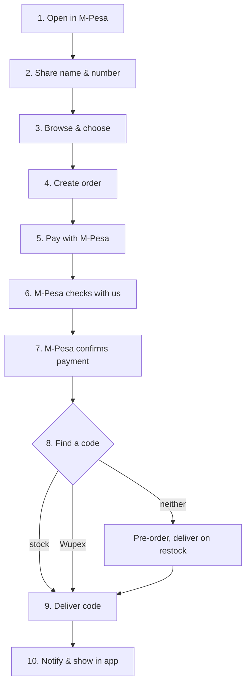

# Flow Walkthrough: every step, twice

Back to [[00 Home]]

Each step has a **🔧 technical** explanation and a **💬 simple** one, so the same page works for both audiences.

---

### 1. Open eCards in M-Pesa
- 🔧 M-Pesa opens the H5 Entrance URL `https://ecards.paperless.et/` in its web view. The user agent contains `MiniProgram`, so `ecards-api.js` loads `hylid-bridge` 2.10.0 and gets the global `my`. The page finds the API through `/health` on the same origin.
- 💬 The customer taps the eCards tile and our shop opens inside M-Pesa.

### 2. Share name and number (login)
- 🔧 `my.call('userScopes', {scopes:[USER_ID, USER_NAME, USER_MNAME, USER_LNAME, USER_MOBILE]})` returns `kycAllowed`. The page sends `POST /v1/auth/mpesa {profile, deviceKey}`. The server upserts the customer and creates a session (`verified=false`, `device_hash`). It returns an opaque token, stored only as a hash.
- 💬 M-Pesa asks "Allow eCards to see your name and number?" The customer taps Allow. No password needed.

### 3. Browse and choose
- 🔧 `GET /v1/catalog` returns brands, products, Birr prices (`round(USD×rate)`, VAT included), stock flags and the home layout. Cached 30 s.
- 💬 The customer sees the cards and prices in Birr and picks one.

### 4. Create the order
- 🔧 `POST /v1/orders` with an `Idempotency-Key`. The server validates the limits, prices from the DB, and snapshots the rate and VAT. It creates `EC########` with status `pending_payment`, `expires_at` = now + 15 min, and the `device_hash`.
- 💬 The system writes an order with a number and the exact price. The phone can't change the price.

### 5. Pay with M-Pesa
- 🔧 `POST /v1/orders/:id/pay` creates a `payments` row and returns `clientAction`. The page calls `my.call('payWithMpesa', {businessID, billReference: 'EC…', amount: '150.0', currency: 'ETB', reason})`. The result goes to `POST /pay-result`, which is informational only. A cancel (`201`) means a retry gets bill reference `EC…R2`.
- 💬 The normal M-Pesa payment screen opens. The customer enters their PIN.

### 6. M-Pesa checks with us (Validation)
- 🔧 Safaricom sends `POST /v1/webhooks/mpesa-c2b/<secret>/validation`. We look up the `BillRefNumber` and compare `TransAmount`. We reply `0` (accept), `C2B00012` (unknown account) or `C2B00013` (wrong amount).
- 💬 Before taking the money, M-Pesa asks us "is this right?" We only say yes for the correct order and amount.

### 7. M-Pesa confirms the payment (Confirmation)
- 🔧 `POST …/confirmation` is stored in `webhook_events`. The shortcode, reference and amount are checked. The payment becomes `succeeded` (receipt = `TransID`), the order becomes `paid`, and a `fulfil_order` job is queued. Duplicates are ignored. A mismatch is acknowledged, audited and shown in Payments review.
- 💬 M-Pesa tells us "money received". Only now do we treat the order as paid.

### 8. Find a code
- 🔧 The worker claims from stock with `FOR UPDATE SKIP LOCKED`, otherwise uses the provider (Wupex pull-codes with our `referenceId`, recorded before the call, looked up by that reference if the answer is lost; Wupex pre-orders are delivered as codes arrive), otherwise the line stays `waiting` with an ETA and the order becomes `awaiting_stock`.
- 💬 We take a code from our own stock. If we have none, we buy one from Wupex on the spot. If that's not possible, the customer gets a pre-order.

### 9. Deliver
- 🔧 Codes are linked to the order line, `delivered_quantity` is updated, and the order becomes `completed` when all lines are delivered. Restocks fill `waiting` lines oldest first.
- 💬 The code now belongs to the customer's order.

### 10. Notify and show
- 🔧 A notification is queued (SMS/email adapter, currently a log). The app polls `GET /v1/orders?full=1` every 20 s. Codes are decrypted only for the owner's device; other devices get `codesHidden`.
- 💬 The code appears in the app (and by SMS once connected). Only the phone that bought it can see it.

---

### Other paths
| Situation | 🔧 What happens | 💬 In plain words |
|---|---|---|
| Customer cancels payment | Attempt `cancelled`; retry with `…R2` | Nothing charged; try again |
| No payment in 15 min | `expire_orders` job: `expired` | The order times out |
| Wrong amount paid | Acknowledged, not fulfilled, audit plus review queue | Staff check it and refund or fix it |
| Wupex timeout | `unknown`, then look up by `referenceId`; re-buy only if Wupex never got it (90 s) | We double-check before buying again |
| Same order seen on another phone | `codesHidden: true` | Codes stay on the buyer's phone |
