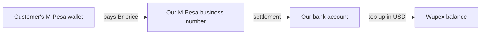

# How Money and Cards Move

Back to [[00 Home]] · Technical: [[Payments – M-Pesa Ethiopia]] · [[Gift Cards – Wupex]] · [[Orders and Fulfilment]]

## The money

1. The customer pays **our business number** in M-Pesa. The order number is attached as the "bill reference".
2. Before taking the money, M-Pesa **asks our server**: "Is order EC12345678 for Br 6,500 correct?" Our server says yes or no. This stops wrong payments.
3. After the money moves, M-Pesa **tells our server**: "Received, receipt QAYGDMWP8S". **Only this message counts as paid.** What the phone says is not enough.
4. We top up our Wupex balance in dollars, separately, to keep buying codes.

## The cards
When an order is paid, the server gets the codes this way:

1. **Do we have it in stock?** Codes we bought earlier are waiting, encrypted. Take the oldest one.
2. **No stock? Buy it now from Wupex.** The server asks Wupex, pays from our Wupex balance and gets the code back within seconds.
3. **Wupex out of stock too?** Wupex can order it from its own suppliers, and we hand the code over as soon as it comes in. If not, it becomes **our pre-order**. The customer has paid and sees a date. When we add stock, it is delivered automatically.

## Safety rules (why nobody loses)
- **One code, one customer.** Two people buying at the very same second can never get the same code.
- **No double buying.** If Wupex is slow and we're not sure a purchase went through, we **check first** using our own order number, and never just buy again.
- **No "free" cards.** A wrong amount or an unknown order number is never delivered. Staff see it in "Payments review".
- **Duplicates ignored.** If M-Pesa sends the same "paid" message twice, it counts once.

Next: [[Where It Runs and How It Is Kept Safe]]
