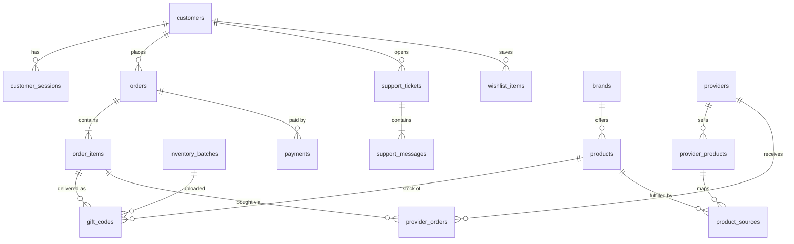

# Database

Back to [[00 Home]] · Related: [[Orders and Fulfilment]] · [[Security]]

PostgreSQL 16 with 27 tables, 1 view and 3 migrations. Plain SQL, no ORM.

## Conventions
- **Money.** Birr amounts are stored as **santim** in `BIGINT` columns named `*_minor` (Br 150.00 = `15000`). Gift card face values and provider costs are stored as **USD cents** (`*_cents`).
- **Prices.** `price = round(face_value_usd × usd_etb_rate)`, rounded to a whole Birr. VAT (15 %) is *included* in the price.
- **Snapshots.** Each order stores the `usd_etb_rate` and `vat_rate` used, so changing settings later never changes past orders.
- **Status columns** are `TEXT` with a `CHECK` list. This is easy to read in SQL and easy to extend.
- **IDs** are UUIDs (`gen_random_uuid()`). Human references are `EC` + 8 digits for orders and `T` + 6 digits for tickets.
- `updated_at` is maintained by triggers.
- **Secrets are never stored in the clear.** Gift codes are encrypted, and session tokens and passwords are hashed.

## Migrations
The migrator (`npm run migrate`) takes a Postgres **advisory lock**, applies each file in a transaction, and records it in `schema_migrations`. It is safe to run twice or from two places at once.

| File | Adds |
|---|---|
| `001_init.sql` | The whole schema below |
| `002_wupex_miniapp.sql` | `customers.msisdn` and `payments.msisdn` become nullable (mini app logins may not share a phone); payment methods `mpesa_miniapp` and `mock`; `provider_orders.request_context` JSONB (Wupex marker); unique `(provider_id, external_transaction_id)`; `provider_products.price_cents` |
| `003_mpesa_et.sql` | `customer_sessions.device_hash` + `verified`; `orders.device_hash`; `payments.client_result` JSONB; webhook source `mpesa_c2b` |

## Tables by area

### Customers and sessions
- `customers`: M-Pesa user id, name, msisdn, language, delivery preference (sms/email, address)
- `customer_sessions`: token **hash**, expiry, `device_hash`, `verified`
- `wishlist_items`

### Staff
- `admin_users`: email, **scrypt** password hash, role (`owner`/`admin`/`support`/`viewer`), failed-login counter, lock time
- `admin_sessions`
- `audit_log`: who did what, and when (settings changes, code reveals, voids, payment mismatches…)

### Catalogue and home screen
- `app_settings` (single row): USD→ETB rate, VAT rate, low-stock threshold, auto-fulfil, max quantity per line (10), max order total (Br 500,000), payment timeout (900 s), default restock days (3), support contacts
- `brands`: id like `netflix`, colours and style used to draw the card, category, hidden/active
- `products`: brand × face value (USD cents), active, restock ETA
- `home_banners`, `home_popular_brands`, `home_row_items`
- view `product_stock`: available codes per product

### Stock
- `inventory_batches`: each upload of codes (source, supplier, count, note)
- `gift_codes`: **encrypted** code and pin (AES-256-GCM), HMAC **fingerprint** (unique, which stops duplicate uploads), `last4`, status `available` → `sold` (or `void`), `order_item_id`, `customer_used_at`

### Orders and payments
- `orders`: reference, customer, status, totals (subtotal, VAT, total), snapshots, delivery target, language, channel, idempotency key, `expires_at`, `device_hash`
- `order_items`: product, title, face value, quantity, `delivered_quantity`, unit/line price, status, `eta`
- `payments`: one row per attempt; method, status, `checkout_request_id` (the bill reference for ET), receipt (M-Pesa TransID), amount, msisdn, `client_result` (what the app reported)
- `webhook_events`: every callback's raw body, source, processed time and error

### Providers (Wupex)
- `providers`: id, name, adapter, enabled, priority, health status
- `provider_products`: the provider's catalogue (SKU, name, face value, price)
- `product_sources`: which provider SKU fulfils which of our products, and at what priority
- `provider_orders`: **written before** every purchase: unique `custom_identifier`, quantity, cost, status (`pending`/`succeeded`/`failed`/`unknown`…), `external_transaction_id`, `request_context`
- `provider_api_calls`: a log of every provider HTTP call (no codes in it)

### Messaging and support
- `notifications`: queued, sent or failed SMS/email
- `support_tickets`, `support_messages`

### Jobs
- `jobs`: type, payload, `dedupe_key` (unique while queued), `run_at`, attempts / `max_attempts`, status `queued`/`running`/`done`/`dead`

## Simplified ER diagram

## Where the database lives
- **Production/staging (VPS).** Docker container `ecards-db` (`postgres:16-alpine`), data in the Docker volume `ecards-pgdata`. It listens only on `127.0.0.1:5433`, so it is separate from the other PostgreSQL that Odoo uses. The password is in `/root/ecards-db.pass` and inside `DATABASE_URL` in `/opt/ecards/.env`.
- **Development and tests.** A local PostgreSQL 16. Tests create and reset their own database.

Backup commands are in the [[Operations Runbook]].
