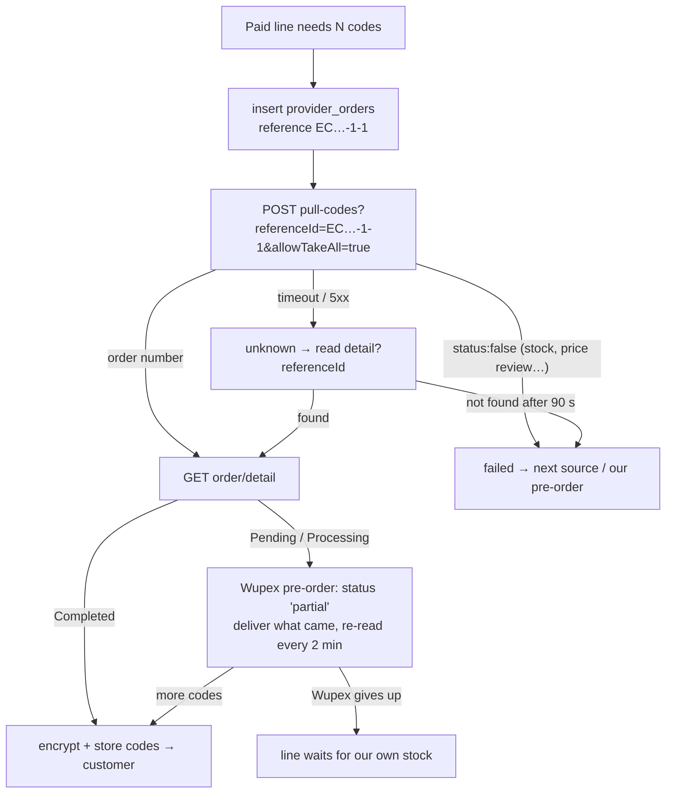

# Gift Cards – Wupex

Back to [[00 Home]] · Simple version: [[How Money and Cards Move]]

Wupex is the gift card wholesaler. We buy codes through their API, paid from our Wupex account in USD. In the sandbox that account is a credit line of 10,000 USD.

The adapter is `server/src/adapters/giftcards/wupex.ts`. It follows the **Wupex API Reference v1.1 (June 2026)** plus its Postman collection. **Status: working against the Wupex sandbox** (checked 2026-11-02 with real sandbox orders and a real pre-order).

## Account and settings
| Item | Value |
|---|---|
| Sandbox portal | `https://sandbox-portal.wupex.com` (browser only. Its `/__wupex` path **refuses API calls**.) |
| **API (service) URL** | sandbox `https://sandbox-service.wupex.com` · production: the service URL Wupex gives you (portal `https://portal.wupex.com`) |
| Merchant code | `Paperless345` (portal → avatar, top right) |
| API key | in the portal. Stored only in `/opt/ecards/.env` as `WUPEX_API_KEY`. **Never in git or these notes.** |
| Currency | USD |
| `.env` | `GIFTCARD_ADAPTER=wupex`, `WUPEX_BASE_URL`, `WUPEX_API_KEY`, `WUPEX_MERCHANT`, `WUPEX_CURRENCY=USD` |

## Endpoints used
Headers: `x-api-key`, `Accept-Language: en`, `Content-Type: application/json`.

| Call | Use |
|---|---|
| `GET /api/customer/balance` | `{balance, credit, creditBalance}`. **`creditBalance` is what we can spend.** `balance` goes negative as the credit line is used. |
| `POST /api/product/merchant/invited/list` `{page, pageSize≤100}` | Catalogue sync. Vouchers only; top-ups (which need a player id) are skipped. |
| `POST /api/order/pull-codes?referenceId=<ours>&allowTakeAll=true` `[{merchant, sku, quantity}]` | **Buy.** Returns only the order number (`orderName`), never the codes. |
| `GET /api/order/detail?orderName=…` or `?referenceId=…` | **Codes** (`serialCode`, `serialNumber`, `securityCode`, `expiry`) and delivery progress |
| `GET /api/preorder/status` | Whether Wupex pre-orders are switched on (they are) |

## How a purchase works now
Wupex accepts **our own reference** on every order (`referenceId`). We send our `provider_orders.custom_identifier`, for example `EC62270851-1-1`, which is the order number, line and attempt. This makes buying simple and safe:
- **The same reference twice = one purchase.** Wupex answers `ALREADY_COMPLETED` with the same order and charges nothing (tested live).
- **After a timeout,** we read `order/detail?referenceId=…`:
  - if the order exists, we take its codes;
  - if Wupex has no order with that reference after 90 seconds, it never got it, and the card is bought again under a new reference.
- Purchases run **side by side**. The old "one at a time plus marker" workaround is gone.

## Wupex pre-orders
When Wupex has fewer codes than we ask for, and the product allows pre-orders, it:
- delivers what it has right away;
- buys the rest from its suppliers immediately, retrying every 10 minutes up to 10 times;
- **charges only for what it delivers.**

Our side:
- The purchase is stored as `partial` (migration `004_provider_preorders.sql`). We re-read it every 2 minutes.
- **New codes go to the customer as they arrive**, with an SMS notification queued each time.
- While it's open, **no second purchase** is made for that line. This is tested, and the test fails if the guard is removed.
- If Wupex gives up (`Failed`), we keep what was delivered, and the line waits as our own pre-order: a stock upload fills it, or the periodic retry tries again.
- If our own stock arrives first, it is used first. Codes Wupex delivers later go into our stock, so they are never lost.

Products **without** Wupex pre-order support answer `Insufficient Stock`. The line then waits as our pre-order and nothing is charged.

## Errors
Errors arrive as **HTTP 200** `{status:false, description}`:

| description | Meaning | We do |
|---|---|---|
| `RequestId:… \| Insufficient Stock` | not enough codes, no pre-order | failed, retry later |
| `[PRICE_REVIEW_REQUIRED] …` | product not sellable to us (or unknown SKU) | failed, not retried |
| `File not found.` | no order with that number/reference | "not found" |
| timeout, HTTP 5xx | unknown | look up by reference |

## Mapping products
Our cards are brand × USD value, and each must point to a Wupex SKU.
- `provider:map wupex` syncs the catalogue and shows the match for each of our cards (USA first, then global) with the **cost = the Wupex `price`**. That price is already the face value minus Wupex's discount, for example Apple $5 costs $4.90. Add `--apply` to save.
- **New:** `--add-values --apply` first **adds our card for every value Wupex sells in brands we carry**. It also lists Wupex brands we don't carry yet (sandbox: **Roblox**). Add those in Admin → Brands, with name, colours and category, then run it again.
- You can also map by hand in Admin → Providers.

### What the sandbox sells (2026-11-02)
| Brand | Values (USD) |
|---|---|
| Apple | 5, 10, 15, 20, 25, 30, 35, 40, 50, 100, 200, 300, 400, 500 |
| Google Play | 15, 25, 50, 100 |
| PlayStation (USA) | 25, 30, 50, 55, 70, 75, 100, 110 |
| Steam | 10 (pre-order only) |
| Roblox | 15, 20, 75, 100, 150, 200 (brand not in our catalogue) |
| Razer Gold | 2 |

There is **no Netflix, Xbox, Spotify or PUBG** in the sandbox. Ask Wupex about the production catalogue. Those cards can still be sold from uploaded stock.

> [!warning] Sandbox price quirk
> **Apple $15** is priced at **$15.68**, above its face value, because Wupex's `faceValue` field says 16. Make sure the selling rate covers the cost on such cards. In production, check prices after the first sync.

## Live sandbox results (2026-11-02)
| Check | Result |
|---|---|
| Balance | ✅ credit 10,000, spendable `creditBalance` read correctly |
| Product sync | ✅ 34 products, 27 of our cards mapped after `--add-values` |
| Buy Apple $5 through eCards (mock M-Pesa) | ✅ order completed, Br 1,325, cost $4.90, code and serial stored encrypted, SMS queued. Wupex took ~8 s to answer. |
| Same `referenceId` twice | ✅ one Wupex order, no second charge |
| Buy Steam $10 (no stock) through eCards | ✅ Wupex pre-order `P…`, tracked as `partial`, re-read every 2 min |
| Unknown SKU | ✅ `PRICE_REVIEW_REQUIRED` → failed, not retried |

## Logging
Every call is written to `provider_api_calls`: endpoint, status, timing and a short note, **never codes**. It is shown in **Admin → Providers → Log**.

## Tests
`wupex.test.ts` has 15 tests against `test/fakes/wupex.ts`, which behaves like the real sandbox. They cover:
- error parsing; balance; the product list;
- a purchase with codes read from the order;
- the same reference bought twice;
- each error outcome;
- partial stock;
- mapping, including adding the missing values;
- a full order;
- a timeout after Wupex charged and a timeout before it got the order;
- purchases running side by side;
- a Wupex pre-order delivered in two parts (with a retry happening mid-way);
- a pre-order with nothing in stock;
- a pre-order Wupex gives up on;
- no stock and no pre-order.
