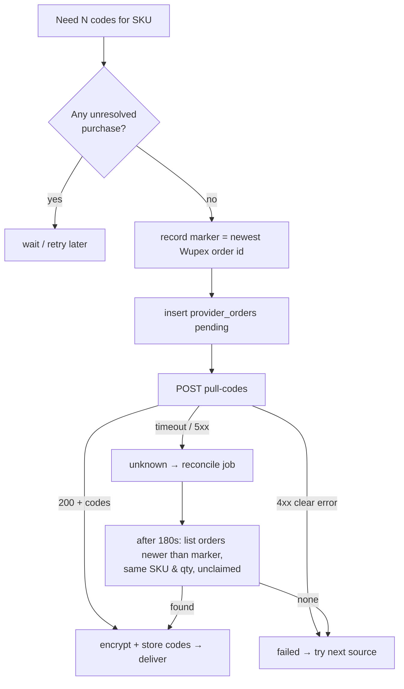

# Gift Cards – Wupex

Back to [[00 Home]] · Simple version: [[How Money and Cards Move]]

Wupex is the gift card wholesaler. We prepay a balance with them, and their API "pulls" codes, which are returned in the reply. Docs: `https://wupex.com/api-doc-overview/`.

The adapter is `server/src/adapters/giftcards/wupex.ts`. It is enabled with `GIFTCARD_ADAPTER=wupex` plus `WUPEX_BASE_URL`, `WUPEX_API_KEY`, `WUPEX_MERCHANT` and `WUPEX_CURRENCY`. **Status: built and tested against a fake Wupex server. Waiting for real API keys.**

## Endpoints used
Headers: `x-api-key: <key>` and `Accept-Language: en-US`.

| Call | Use |
|---|---|
| `GET /api/customer/balance` | Health check and low-balance warning |
| `GET /api/product/merchant/invited/list` (paged) | Product catalogue sync |
| `POST /api/order/pull-codes` with body `[{merchant, sku, quantity}]` | **Buy**: codes come back in the response |
| `GET /api/order/detail?orderName=` | Look up one order |
| `GET /api/order/list` | Find recent orders (used for reconciliation) |

## The hard part: Wupex accepts no client reference
Most APIs let you send your own idempotency key, so "did my purchase go through?" is easy to answer after a timeout. Wupex has no such key. If a purchase times out, we can't ask "what happened to *my* request X?". Buying again could pay twice.

**Our solution:**
1. **One purchase at a time.** Purchases are serialised with a Postgres advisory lock, and a new purchase **does not start while an earlier one is unresolved**.
2. **Marker.** Before buying, we record the newest Wupex order id in `provider_orders.request_context`.
3. **Reconcile.** After an unknown outcome, the `reconcile_provider_order` job waits for a settle window (180 s). It then lists orders **newer than the marker** with the **same SKU and quantity** that aren't claimed yet. If it finds one, it takes the codes from `order/detail`. If not, the purchase is considered not made, and it is safe to try again.
4. **No double claim.** A unique index on `(provider_id, external_transaction_id)` makes it impossible for two of our orders to claim the same Wupex order.

## Mapping products
Our products (brand × USD face value) must be linked to Wupex SKUs.
- `npm run provider:map` (or **Admin → Providers → Sync / Auto-map**) pulls the Wupex catalogue into `provider_products` and suggests matches by brand name and face value.
- Staff confirm or adjust the matches in **Admin → Providers** (`PUT /v1/admin/products/:id/sources/:providerId`), with a priority if more than one source exists.
- `provider_products.price_cents` stores the wholesale cost, which is used for margin checks.

## Logging
Every call is written to `provider_api_calls`: endpoint, status, timing and a redacted body, **never codes**. It is shown in **Admin → Providers → Log**.

## What we need from Wupex
Sandbox and production API keys, the merchant code, the account currency, whether **IP allow-listing** is needed (our server IP is `91.107.204.59`), rate limits, and the exact error codes for "insufficient balance" and "out of stock". See [[Questions for Partners]].

## Tests
`wupex.test.ts` (10 tests) runs against `test/fakes/wupex.ts`. It covers happy path, paging, timeout then reconcile-found, timeout then reconcile-none, concurrent purchases, and the double-claim guard.
