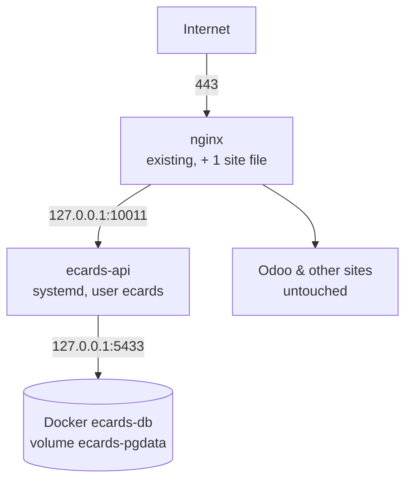

# Infrastructure and Deployment

Back to [[00 Home]] · Commands: [[Operations Runbook]] · Simple version: [[Where It Runs and How It Is Kept Safe]]

## Current setup (staging)
| Item | Value |
|---|---|
| Server | VPS `91.107.204.59`, Ubuntu 22.04, **shared** with Odoo, other Docker apps, nginx, PostgreSQL, Node/pm2 and MariaDB |
| Rule | **Don't affect the existing services.** Everything eCards is separate. |
| Domain | `ecards.paperless.et` (A record → 91.107.204.59, set in the cPanel zone editor) |
| nginx | `/etc/nginx/sites-available/ecards.paperless.et` → `proxy_pass http://127.0.0.1:10011` |
| HTTPS | Let's Encrypt via certbot. The system certbot is broken by a Python `cryptography` conflict, so use the **snap** certbot (see below). **Status: to confirm.** |
| App | `/opt/ecards/releases/<timestamp>` with `/opt/ecards/current` → active release |
| Node | Private Node 22 in `/opt/ecards/node` (the system Node is not touched) |
| User | `ecards` (system user) |
| Service | systemd `ecards-api` (`/etc/systemd/system/ecards-api.service`) |
| Config | `/opt/ecards/.env` (mode 600; keys generated by the installer; kept across updates) |
| Database | Docker `ecards-db` (`postgres:16-alpine`), volume `ecards-pgdata`, `127.0.0.1:5433` → 5432; password in `/root/ecards-db.pass` |
| Source checkout | `~/ecards-src` (git clone of branch `backend-api`) |
| Mode | **Staging**: `NODE_ENV=production`, `ALLOW_MOCK_ADAPTERS=true`, mock payments, mock provider, demo codes |



## The deploy kit (`server/deploy/`)
### `pack.sh`
Builds `server/release/ecards-server.tar.gz`, containing `dist/`, migrations, package files, `deploy/`, README, `.env.example` and `public/` (index.html, admin.html, web.html, assets).

### `install.sh` (install **and** update)
1. **Read-only preflight**, which changes nothing:
   - OS, memory and disk;
   - checks that the port is free (with fallbacks if `ss` is missing);
   - checks PostgreSQL;
   - **refuses to reuse an existing DB role or database**;
   - checks the firewall type.
   Run it with `--check` to do only this.
2. Creates the `ecards` user and installs a private Node in `/opt/ecards/node`.
3. Database:
   - uses `ECARDS_DATABASE_URL` if given (our case: the Docker container);
   - otherwise adds one DB and role to the existing PostgreSQL.
4. Writes `.env` with freshly generated keys, but **only on the first install**. Updates keep it.
5. Unpacks to a new release folder, runs `npm ci --omit=dev`, runs migrations and seeds on the first install, then switches the `current` symlink.
6. Installs and starts systemd `ecards-api`, then waits for `/health`.
7. **Automatic rollback** to the previous release if the new one doesn't become healthy.
8. Firewall: opens the port in ufw/firewalld **only if** the app is not on `127.0.0.1`. Behind nginx, nothing is opened.

### `uninstall.sh`
Stops and removes the service, `/opt/ecards` and the user. With `--drop-database`, it drops only the database named in `.env`. It never touches container databases or other DBs.

### `ecards-api.service`
`WorkingDirectory=/opt/ecards/current`, `EnvironmentFile=/opt/ecards/.env`, `ExecStart=/opt/ecards/node/bin/node dist/index.js`, `MemoryMax=512M`, `CPUQuota=50%`, `Nice=10`, `Restart=on-failure`, `TasksMax=200`, low IO priority, plus hardening (`NoNewPrivileges`, `ProtectSystem=strict`, `ProtectHome`, `PrivateTmp`, `PrivateDevices`, kernel protections).

## How it was deployed (what was run)
1. **Recon** (read-only): services, ports, Docker containers, ufw, disk, memory.
2. **Clone:** `git clone -b backend-api https://github.com/Yesunewh/SE-eCards-MPesa_Miniapp.git ~/ecards-src`
3. **Pack:** `cd ~/ecards-src/server && bash deploy/pack.sh`
4. **Database container** (port 5433 was checked free first):
   ```bash
   docker run -d --name ecards-db --restart unless-stopped \
     -e POSTGRES_USER=ecards -e POSTGRES_DB=ecards -e POSTGRES_PASSWORD="$(cat /root/ecards-db.pass)" \
     -p 127.0.0.1:5433:5432 -v ecards-pgdata:/var/lib/postgresql/data postgres:16-alpine
   ```
5. **Preflight, then install:**
   ```bash
   cd ~/ecards-src/server && ECARDS_DATABASE_URL="postgres://ecards:$(cat /root/ecards-db.pass)@127.0.0.1:5433/ecards" \
     bash deploy/install.sh release/ecards-server.tar.gz --check
   ```
   Then run the same command without `--check`. Result: service running, health OK, owner admin `info@paperlessts.com` created.
6. **nginx** site for `ecards.paperless.et` added, `nginx -t` OK, reloaded.
7. **HTTPS**: certbot failed with a Python traceback (a system pip `cryptography` conflict). The fix is to install the snap certbot (below).
8. **Update to migration 002** (Wupex and mini program): done, and the sandbox token test is OK.
9. **Update to migration 003** (M-Pesa ET): **pending**. Pull commit `f50be11` or later and re-run install.

## Finishing HTTPS (pending)
```bash
sudo snap install --classic certbot
```
```bash
sudo ln -sf /snap/bin/certbot /usr/local/bin/certbot
```
```bash
sudo certbot --nginx -d ecards.paperless.et
```
```bash
sudo certbot renew --dry-run
```
Then, in `/opt/ecards/.env`, set `HOST=127.0.0.1` and `PUBLIC_BASE_URL=https://ecards.paperless.et`, and run `sudo systemctl restart ecards-api`. The snap certbot's renewal timer also renews the other sites' certificates, which the broken system certbot could not.

## History
- **First target**: the old VPS `196.189.51.169` (user `hmg`). It hosts a cloud call-centre system. Installation stalled on a slow Node download, so it was **abandoned**. Nothing there was changed apart from the partial install files. Its credentials will be rotated.
- **cPanel** hosts only static files (the SEO site through the FTP GitHub Action). It can't run the Node server.
