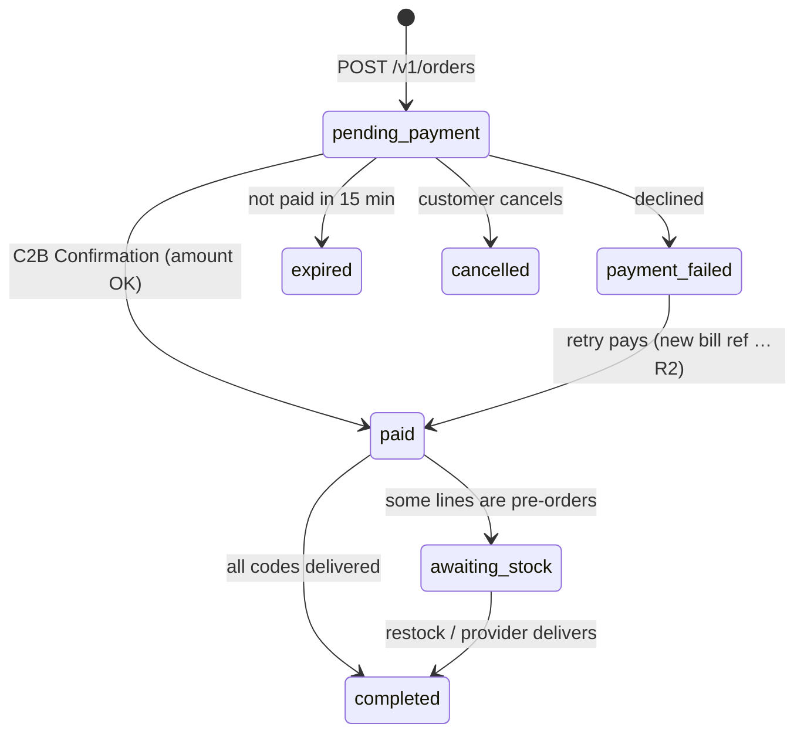

# Orders and Fulfilment

Back to [[00 Home]] · Simple version: [[How Money and Cards Move]]

## Order lifecycle



Line items have their own states: `pending` (not paid), `waiting` (paid, codes still owed), `delivered` and `cancelled`. Partial delivery is allowed: `delivered_quantity` counts up to `quantity`.

## Creating an order (`createOrder`)
1. Validate the cart: at least 1 line and at most 20; quantity is a whole number ≥ 1; at most `max_qty_per_line` of a product; the total is within `max_order_total_minor`.
2. Resolve products **from the database**. The phone sends only `productId` (or `brandId` + face value) and a quantity. Prices are never taken from the phone.
3. Work out the delivery target (SMS phone in `+2517…`/`+2519…` format, or email).
4. **Idempotency:** a repeated `Idempotency-Key` returns the same order. Two identical requests at the same moment produce one order.
5. Insert the order with a random `EC########` reference (redrawn on collision), the rate and VAT snapshot, and the `device_hash` of the session.

## Getting paid
See [[Payments – M-Pesa Ethiopia]]. Only the **C2B Confirmation** callback, with the matching bill reference **and** amount, moves an order to `paid` and queues `fulfil_order`.

## Fulfilment (`fulfilOrder`)
For each `waiting` line, in this order:

1. **Own stock.** The oldest available codes are claimed:
   ```sql
   UPDATE gift_codes SET status='sold', order_item_id=$1, sold_at=now()
   WHERE id IN (SELECT id FROM gift_codes
                WHERE product_id=$2 AND status='available'
                ORDER BY created_at, id LIMIT $3
                FOR UPDATE SKIP LOCKED)
   ```
   `SKIP LOCKED` means two orders can never get the same code, even at the same instant.
2. **Providers** (Wupex), by priority, if the product is mapped and the provider is enabled:
   - Insert `provider_orders` (status `pending`, unique `custom_identifier`) **before** calling out.
   - Call the provider. The result is one of:
     - success: codes are encrypted and saved, and the line is updated;
     - failure: no money left the wallet, so try the next source;
     - **unknown** (timeout or 5xx): mark it `unknown` and queue `reconcile_provider_order`. It is **never** bought again blindly.
   - If a provider sends more codes than needed, the extras go into stock and are never lost.
3. **Otherwise** the line stays `waiting` as a pre-order with an ETA (product ETA, or today + `default_restock_days`). The order becomes `awaiting_stock`.

`settleOrder` then sets the order to `completed` (everything delivered) or `awaiting_stock`, and queues the notification.

## Restock and pre-orders
When staff paste codes (`POST /v1/admin/stock/:productId/codes`), the codes are deduplicated by HMAC fingerprint and encrypted. Then, if `auto_fulfil` is on, **waiting orders for that product are filled, oldest first**. The customer's app picks this up within 20 seconds (polling) and a notification is queued.

`retry_waiting` periodically tries providers again for waiting lines.

## Admin actions
- **Retry**: re-queue fulfilment for an order.
- **Resend**: send the notification again.
- **Reveal**: decrypt the codes in the admin view. This is written to `audit_log`.
- **Void code**: take a bad code out of stock.

## Tests that cover this
`fulfilment.test.ts` (11 tests) and `orders.test.ts` (9 tests): concurrency (no double-sell), partial delivery, restock order, unknown provider outcome, extra codes, idempotency, price tampering. See [[Testing]].
