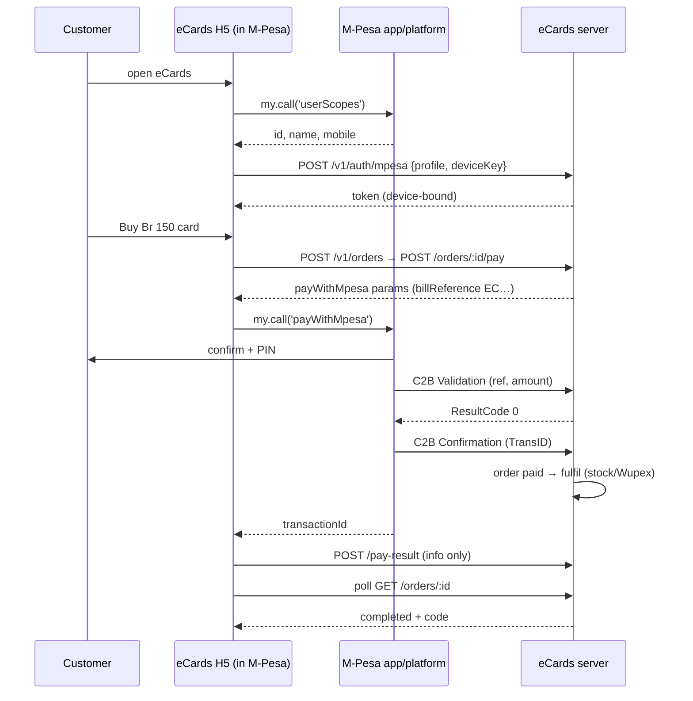

# Payments – M-Pesa Ethiopia (H5 mini app)

Back to [[00 Home]] · Simple version: [[How Money and Cards Move]]

This follows the official Safaricom Ethiopia developer docs (H5 mini app, SSO/userScopes, Pay, C2B, onboarding procedure). We chose the **H5 mini app** path: our normal web page (`https://ecards.paperless.et/`) opens inside the M-Pesa app and talks to it through the `my.call` JS bridge. **STK push is not used** (decision of 2026-11-01; see [[Decisions Log]]).

Adapter: `server/src/adapters/payments/mpesaEt.ts`. Enable it with `PAYMENTS_ADAPTER=mpesa_et`.

## Setup on the M-Pesa side (portal)
| Item | Value |
|---|---|
| Developer portal | developer.safaricom.et (app created; sandbox consumer key and secret issued, OAuth token tested OK) |
| Mini program portal | `https://portal.miniapps.eth.m-pesa.com`. Registration is **by invitation**, and **access is pending**. |
| Mini program type | **HTML5** |
| Entrance URL | `https://ecards.paperless.et/` |
| Features to enable | **UserScopes** (login data) and **PaymentET** (pay) |
| Merchant / businessID to try | `0711885151` (see the note below) |
| Sandbox base URL | `https://apisandbox.safaricom.et` |
| Token | `GET /v1/token/generate?grant_type=client_credentials` (Basic auth with key:secret) |

> [!question] Merchant number
> `0711885151` was given as the merchant number. It looks like a **phone number**. M-Pesa `businessID` / C2B `ShortCode` is normally a **till or paybill shortcode** (for example 5–7 digits). We must confirm with Safaricom which value goes into `businessID` and C2B registration. Once confirmed, set it as `MPESA_SHORTCODE` in `/opt/ecards/.env`. See [[Questions for Partners]].

## 1) Login: `userScopes`
```js
my.call('userScopes', {
  scopes: ['USER_ID', 'USER_NAME', 'USER_MNAME', 'USER_LNAME', 'USER_MOBILE']
}, res => { /* res.kycAllowed: [{key, value}], res.kycRejected: [...] */ });
```
- Errors: `201` (user cancelled), `102` and `103` (see the docs).
- The app sends `{ profile: { userId, name, msisdn }, deviceKey }` to `POST /v1/auth/mpesa`.
- `deviceKey` is a random value created once and stored on the phone. The server stores only its SHA-256 (`device_hash`).
- **Our server cannot verify this data** (it comes from the phone, with no signature). The session is therefore marked `verified=false` and **bound to the device**: that session sees codes only for orders placed from the same device. See [[Security#Device-bound code access]].

## 2) Pay: `payWithMpesa`
The server returns the parameters from `POST /v1/orders/:id/pay`, and the app calls:
```js
my.call('payWithMpesa', {
  businessID: '<shortcode>',
  billReference: 'EC12345678',   // order reference; retries: EC12345678R2, R3…
  amount: '150.0',               // Birr, one decimal, as a string
  currency: 'ETB',
  reason: 'eCards EC12345678'
}, res => { /* res.transactionId, or res.error */ });
```
- Errors: `101` (pre-validation failed), `102`, `201` (cancelled), `4`, `7`.
- The app reports the result to `POST /v1/orders/:id/pay-result`. That is **stored only** (in `payments.client_result`). A cancel marks the attempt cancelled so the user can try again with a fresh bill reference.

## 3) C2B callbacks: the source of truth
M-Pesa calls our server.

**Validation** (before the money moves): `POST /v1/webhooks/mpesa-c2b/<secret>/validation`
- Unknown `BillRefNumber` → `{"ResultCode":"C2B00012","ResultDesc":"Invalid Account Number"}`
- Wrong `TransAmount` → `{"ResultCode":"C2B00013","ResultDesc":"Invalid Amount"}`
- Otherwise → `{"ResultCode":0,"ResultDesc":"Request processed successfully"}`

**Confirmation** (the money moved): `POST /v1/webhooks/mpesa-c2b/<secret>/confirmation`
- The body is in Daraja format: `TransID`, `TransAmount`, `BusinessShortCode`, `BillRefNumber`, `MSISDN`, `FirstName`…
- Callbacks for another shortcode are ignored.
- The bill reference and amount must match → the payment `succeeded` with the receipt `TransID`, the order becomes `paid`, and fulfilment is queued.
- A duplicate confirmation changes nothing (idempotent).
- Wrong amount → acknowledged but **not fulfilled**, written as `payment.amount_mismatch` in the audit log, and shown under Payments review.
- Unknown reference → acknowledged, stored as `webhook_events.error = 'unknown_payment'`, and shown under Payments review.

### Registering the callback URLs
After the shortcode is confirmed and HTTPS works:
```bash
sudo bash -c 'set -a; . /opt/ecards/.env; set +a; cd /opt/ecards/current && /opt/ecards/node/bin/node dist/scripts/mpesa-register-urls.js'
```
(`npm run mpesa:register-urls` does the same thing in a development checkout.)
It sends:
```
POST {MPESA_BASE_URL}/v1/c2b-register-url/register?apikey=<consumer key>
{ "ShortCode": "<shortcode>", "ResponseType": "Completed", "CommandID": "RegisterURL",
  "ConfirmationURL": "https://ecards.paperless.et/v1/webhooks/mpesa-c2b/<secret>/confirmation",
  "ValidationURL":   "https://ecards.paperless.et/v1/webhooks/mpesa-c2b/<secret>/validation" }
```

## Sequence



## Other payment adapters in the code (not used for Ethiopia)
| Adapter | What it is | Why kept |
|---|---|---|
| `mock` | Test payments: no money moves; staff confirm by recording an M-Pesa receipt | Until the mini program is registered |
| `miniapp` | Generic mini program API (RSA-signed `applyToken`, `payments/pay`, `notifyPayment`, `inquiryPayment`) | Used if the platform switches to the signed-API model |
| `safaricom` | STK push (`/mpesa/stkpush/v3/processrequest`) | Possible option for a future web store |

## Go-live checklist (payments)
1. Get mini program portal access, then create an HTML5 mini program with Entrance URL `https://ecards.paperless.et/` and enable UserScopes and PaymentET.
2. Confirm the shortcode/businessID (`0711885151`?).
3. Confirm HTTPS works, and set `HOST=127.0.0.1` and `PUBLIC_BASE_URL=https://ecards.paperless.et`.
4. In `/opt/ecards/.env`: `PAYMENTS_ADAPTER=mpesa_et`, `MPESA_BASE_URL`, `MPESA_CONSUMER_KEY`, `MPESA_CONSUMER_SECRET`, `MPESA_SHORTCODE`, and a long random `MPESA_CALLBACK_SECRET`. Turn off `ALLOW_MOCK_ADAPTERS`.
5. Restart: `systemctl restart ecards-api`.
6. Run `npm run mpesa:register-urls`.
7. Test in the M-Pesa sandbox app: login, pay a small amount, check that the order completes.
