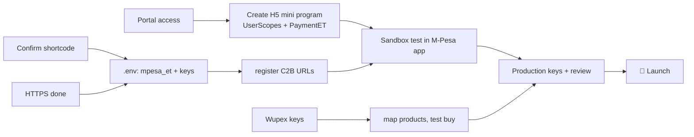

# Status and Roadmap

Back to [[00 Home]] · Simple version: [[What Is Done and What Is Next]]

## Done ✅
| Area | Status |
|---|---|
| Database schema (27 tables, 3 migrations) | ✅ |
| Backend API: customer, admin, webhooks | ✅ |
| Fulfilment engine: stock → provider → pre-order, restock fills oldest first | ✅ |
| Encrypted code vault, audit log, admin roles and lockout | ✅ |
| Wupex adapter with safe reconciliation (no idempotency key on their side) | ✅ (tested with a fake server) |
| Wupex product mapping (CLI and admin) | ✅ |
| M-Pesa Ethiopia H5: `userScopes` login, `payWithMpesa`, C2B validation and confirmation, URL registration | ✅ (tested to the docs) |
| Device-bound code protection | ✅ |
| Mini app and admin panel wired to the API | ✅ |
| 102 automated tests, browser end-to-end runs | ✅ |
| Deploy kit (safe on shared servers, rollback) | ✅ |
| Staging live on VPS 91.107.204.59 behind nginx at `ecards.paperless.et` | ✅ (HTTPS to confirm) |
| Safaricom developer app plus sandbox token test | ✅ |

## Blocked on partners ⏳
| Item | Waiting for |
|---|---|
| Create the HTML5 mini program (Entrance URL, UserScopes, PaymentET) | **Mini program portal access** (by invitation) from Safaricom |
| Merchant number / businessID | Confirm whether `0711885151` (looks like a phone number) is the business shortcode |
| Live M-Pesa credentials and live base URL | Safaricom (after onboarding) |
| Real gift card supply | **Wupex API keys**, merchant code, currency, IP allow-list |
| Sending codes by SMS | An SMS gateway account (Safaricom SMS or a local aggregator) |

## To do on our side 🔧
1. Finish HTTPS with the snap certbot, then set `HOST=127.0.0.1` and `PUBLIC_BASE_URL`. See [[Infrastructure and Deployment#Finishing HTTPS (pending)]].
2. Update the VPS to the latest commit (migration 003). See [[Operations Runbook#Update to the latest code (keeps keys and data; rolls back automatically on failure)]].
3. Add the SMS adapter (and optionally email/SMTP) in `server/src/adapters/notify/`.
4. Native-speaker translations for new messages in `am`, `om`, `so`, `ti`.
5. Wire `web.html` (web store) to the API, or hide it for launch.
6. Set up daily DB backups (cron plus off-server copy) and monitoring (uptime check on `/health`).
7. Upload real starting stock (only after switching off mock payments).
8. Set real prices: USD→ETB rate and margin, in Admin → Settings.

## Go-live sequence

