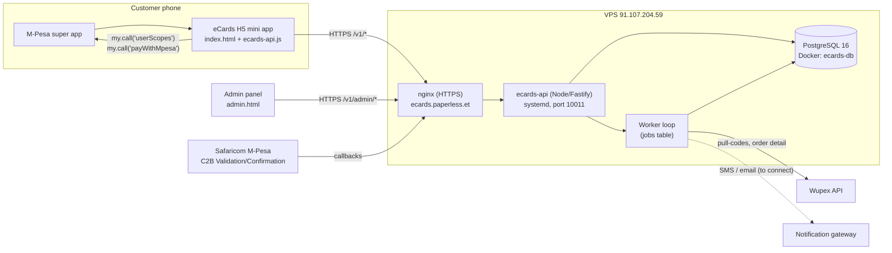

# System Overview

Back to [[00 Home]] · Simple version: [[The Pieces Explained Simply]]

## What the system does
1. It shows a catalogue of gift cards (brand × face value in USD), priced in Birr.
2. It lets an M-Pesa user sign in, add cards to a cart and pay with M-Pesa.
3. When M-Pesa confirms the payment, it delivers codes in this order:
   - from **our own stock** (codes uploaded by staff), otherwise
   - by **buying from a provider** (Wupex), otherwise
   - by keeping the line as a **pre-order** until stock arrives.
4. It shows codes in the app (and SMS/email once a gateway is connected).
5. It gives staff an **admin panel** for orders, stock, prices, home screen, providers, payments review, support tickets and the audit log.

## Architecture

## Components

| Component | Where | Role |
|---|---|---|
| Mini app | `index.html`, `assets/ecards-api.js` | Customer UI inside M-Pesa. Single HTML file plus the API client. |
| Admin panel | `admin.html` | Staff UI: orders, stock, catalogue, providers, support. |
| Web store | `web.html` | Public web version. **Not served**: to be built on the API. |
| API server | `server/src/http` | Fastify app: customer, admin and webhook routes; serves the front end. |
| Services | `server/src/services` | Business logic: catalog, orders, payments, fulfilment, stock, support… |
| Adapters | `server/src/adapters` | Pluggable integrations: payments (mock / mpesa_et / miniapp / safaricom), gift cards (mock / wupex), notify (log). |
| Worker | `server/src/worker.ts` | Background jobs: fulfil, reconcile, expire, retry waiting, notifications. Runs in the same process (`RUN_WORKER=true`). |
| Database | PostgreSQL 16 | All state. Migrations in `server/migrations`. |
| Deploy kit | `server/deploy` | `pack.sh`, `install.sh`, `uninstall.sh`, systemd unit. |
| Native shell | `miniprogram/` | Native mini program web-view shell (Alipay-style). **Not used** for the Ethiopian H5 flow; kept in case it's needed. |
| SEO site | `site/`, `site-builder/` | Static marketing pages, deployed by the existing cPanel FTP workflow. |

## Design principles
- **The server is the source of truth.** Prices, totals and stock are computed on the server, never trusted from the phone.
- **Money is only "received" when M-Pesa says so** through the C2B Confirmation callback. What the app reports is informational.
- **Never lose or double-sell a code.** Codes are claimed with row locks; provider purchases are recorded before the call; an unknown outcome is reconciled, never re-bought blindly.
- **Codes are encrypted at rest** (AES-256-GCM). Admins see only the last 4 characters unless they "reveal", which is audited.
- **Adapters are swappable through configuration.** The same code runs with test payments now and with M-Pesa in production.
- **Don't disturb the host.** The deploy runs beside Odoo and other services without touching them. See [[Infrastructure and Deployment]].

## Related
[[Tech Stack]] · [[Backend API]] · [[Database]] · [[Orders and Fulfilment]] · [[Payments – M-Pesa Ethiopia]] · [[Gift Cards – Wupex]]
